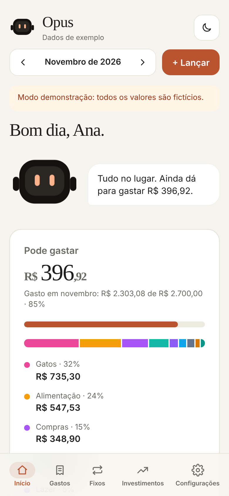
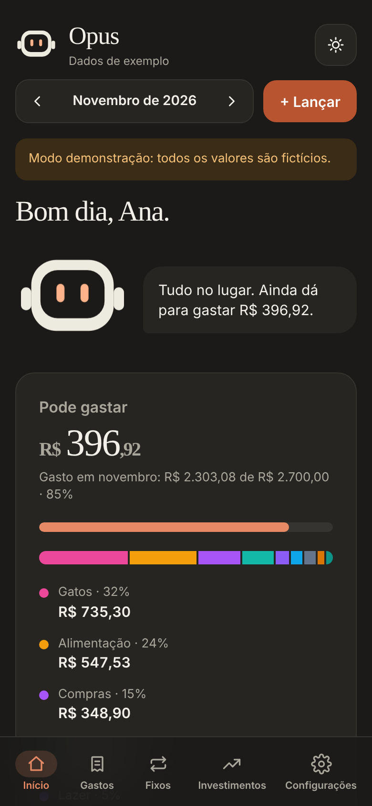
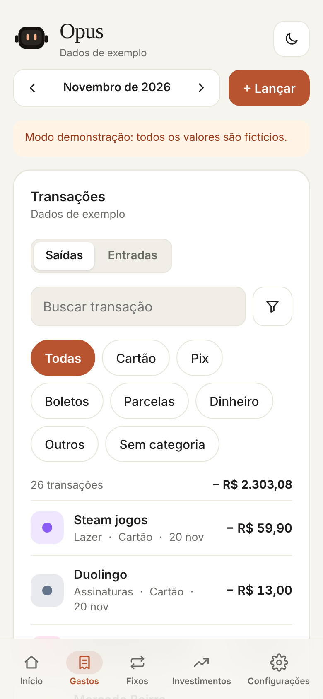

# Opus

Painel pessoal de finanças que lê minha conta do Itaú pelo **Open Finance** (via [Meu Pluggy](https://meu.pluggy.ai)) e mostra para onde o dinheiro está indo, sem planilha manual. Funciona como app instalável (PWA) no iPhone e no Mac.

O app é **somente leitura**: ele não consegue mexer no dinheiro.

<p>
  
  
  
</p>

<sub>Prints no modo demonstração, com valores fictícios.</sub>

## Por que eu fiz

Eu controlava meus gastos numa planilha do Excel, mas era tudo manual e eu esquecia de lançar as compras. O controle do app do banco não é personalizável e não mostra as compras do cartão. Então construí o meu.

## O que ele faz

- **Quanto ainda posso gastar no mês**, com o orçamento dividido por categoria
- **Transações** do Itaú (conta e cartão) puxadas automaticamente, com busca e filtros por forma de pagamento (cartão, Pix, boleto, parcelas, dinheiro)
- **Categorização automática**, que eu posso corrigir. A correção vale para as próximas compras do mesmo lugar
- **Gastos fixos** e **compras parceladas**
- **Investimentos**, incluindo o Cofrinho do Itaú
- **Metas** e **simulação de compras** (à vista no Pix ou no cartão, ou parcelado)
- **Lançamentos em dinheiro** feitos à mão
- **Login com Face ID / Touch ID** (passkey/WebAuthn) ou senha
- **Tema claro e escuro**
- Sincronização opcional entre celular e computador

## Como foi feito

- **Sem dependências.** O front é HTML, CSS e JavaScript puro. O back são funções serverless em Node.js 22 na **Vercel**, usando só a biblioteca padrão
- **Integração com a API da Pluggy** (Open Finance): paginação, tratamento de erro e normalização dos dados do banco num formato único (`lib/normalize.js`)
- **Face ID implementado do zero com WebAuthn**, incluindo um leitor mínimo de CBOR para validar a chave do aparelho (`lib/webauthn.js`)
- **Segurança:**
  - as chaves ficam só nas variáveis de ambiente
  - sessão em cookie assinado com HMAC
  - verificação de origem nas requisições
  - limite de tentativas de login
  - headers restritivos (CSP, `X-Frame-Options`, `noindex`) em `vercel.json`
- Armazenamento opcional no **Upstash Redis** para sincronizar os dados entre aparelhos

## Estrutura

```
public/    site (HTML, CSS, JS, ícones e manifest do PWA)
api/       funções serverless: login, logout, dados, Face ID, armazenamento
lib/       código compartilhado: cliente Pluggy, normalização, sessão, WebAuthn, dados de demonstração
scripts/   servidor local para testar
docs/      prints do README
```

## Rodar no computador

Precisa do Node.js 22.

```bash
npm run dev
```

Abre em http://localhost:3000 no **modo demonstração**, com dados fictícios. A senha é `demo-1234`.

## Publicar na Vercel

Configure em **Settings → Environment Variables**:

| Nome | O que é |
|---|---|
| `APP_PASSWORD` | Senha de acesso (mínimo 8 caracteres) |
| `SESSION_SECRET` | Texto aleatório longo (mínimo 32 caracteres) usado para assinar o login. Para gerar: `openssl rand -hex 32` |
| `PLUGGY_CLIENT_ID` | Client ID da aplicação no dashboard da Pluggy |
| `PLUGGY_CLIENT_SECRET` | Client Secret da aplicação |
| `PLUGGY_ITEM_IDS` | itemId do banco no Meu Pluggy (se for mais de um, separe por vírgula) |
| `DEMO` | Opcional. `1` mostra dados fictícios em vez de ler o banco |

**Sincronizar entre aparelhos (opcional):** na Vercel, abra **Storage** e adicione o **Upstash Redis** no plano gratuito. Ele cria sozinho as variáveis `KV_REST_API_URL` e `KV_REST_API_TOKEN`. Depois, faça um novo deploy.

**Renovar a autorização:** o consentimento do Open Finance expira em 12 meses, e o app avisa 30 dias antes. Para renovar, entre no Meu Pluggy e autorize o banco de novo.
